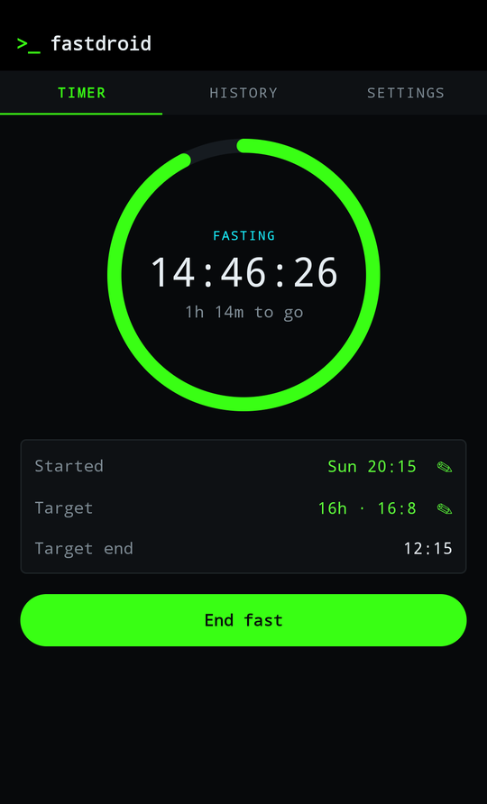
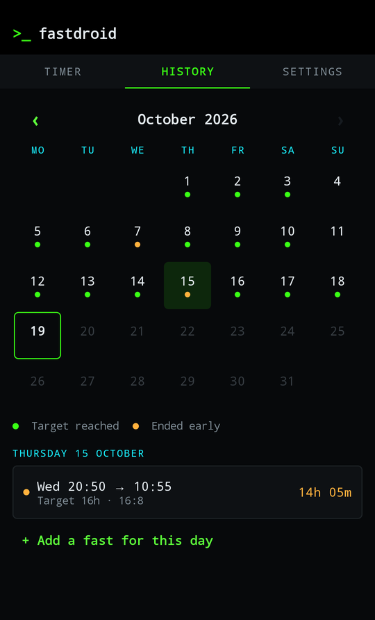
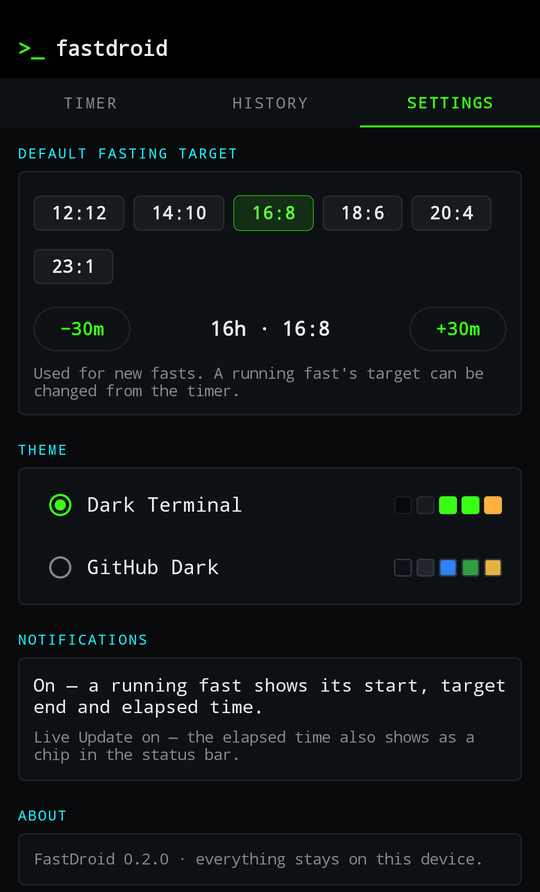
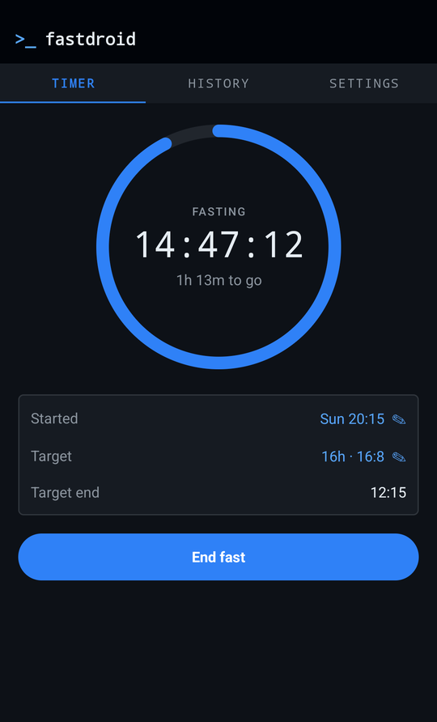

# FastDroid

A deliberately plain intermittent-fasting tracker for Android. Start a fast, end it
whenever you want, see the month at a glance. No streaks, badges, achievements,
ads, accounts or network access — the app doesn't even request the INTERNET
permission.

<p>
  
  
  
</p>
<p>
  
  <br>
  
</p>

<sub>Screenshots use made-up demo data.</sub>

## What it does

- **Timer** — start now or "I started earlier…", with a progress ring and elapsed
  time. The target defaults to 16:8 and is configurable (presets 12:12 to 23:1, or
  anything from 1h to 72h in 30-minute steps). A running fast's own target can be
  changed without touching the default.
- **Ongoing notification** — start time, target end and a live elapsed clock; tap it
  to open the app. There's deliberately no *End fast* button: it was too easy to hit
  by accident. The system renders the clock itself, so nothing runs in the
  background. Swiping it away puts it straight back while a fast is running.
- **Status-bar timer chip** — on Android 16+ the running fast is a Live Update: the
  elapsed time shows as a chip in the status bar and on the lock screen. It can be
  switched off per app in system settings; FastDroid's Settings shows its state.
- **Target alert** — one alarm at the target time. The fast keeps going until you
  end it.
- **End any time** — ending early is a normal outcome, not a failure. Ending offers
  an undo snackbar.
- **History** — a month calendar. A fast belongs to the day it *ended*. A green dot
  means a fast that day reached its target; amber means it ended early. Tap a day to
  edit or delete its fasts, or add one you forgot to track.
- **Themes** — Dark Terminal and GitHub Dark, ported from CyberNewsHub's palette.

## Building

Gradle runs in Docker; nothing but Docker and `adb` is needed on the host.

```bash
scripts/gradle.sh testDebugUnitTest assembleDebug   # JVM tests + debug APK
scripts/install.sh                                  # build, install over ADB, launch
```

The first run builds the `fastdroid-build` image from `docker/Dockerfile`, verifying the
SHA-256 of every tool it downloads. The Gradle cache and the debug signing key live in
`~/.cache/fastdroid-build`, so the key persists between builds (a new key would make
`adb install -r` refuse to update the app). `~/.android` is deliberately not mounted:
it also holds `adbkey`, the key that authorises USB debugging on your phone.

Instrumented tests (Room against real SQLite) need a device; the container has no
USB access, so install both APKs from the host and run them there:

```bash
scripts/gradle.sh assembleDebug assembleDebugAndroidTest
adb install -r app/build/outputs/apk/debug/app-debug.apk
adb install -r app/build/outputs/apk/androidTest/debug/app-debug-androidTest.apk
adb shell am instrument -w io.github.mauricem0ss.fastdroid.test/androidx.test.runner.AndroidJUnitRunner
```

## Layout

| Path | |
|---|---|
| `data/` | Room entity + DAO, settings, and `FastRepository` — the single place that keeps the database, notification and alarm in agreement |
| `domain/` | Pure rules (day attribution, success, validation) and formatting; covered by JVM tests |
| `notify/` | Notifications, the target alarm, and the receiver for notification actions and boot |
| `ui/` | Compose screens: timer, history, settings |

## Security

See [SECURITY.md](SECURITY.md) for the threat model and review findings.

## Licence

EUPL-1.2
